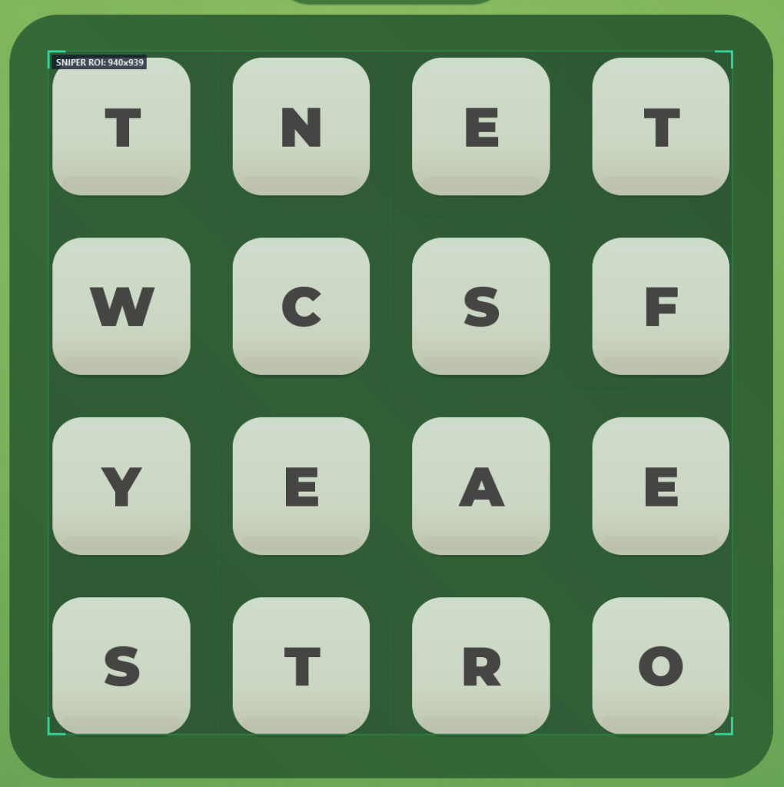

# Word Connect / Word Hunt Finder

[](https://www.python.org/)
[](LICENSE)
[](https://www.microsoft.com/windows)
[](https://riverbankcomputing.com/software/pyqt/)

A complete, high-performance modular computer vision and algorithm suite that solves 4x4 grid word-search puzzle games (Boggle and Word Hunt style). Features both a full PyQt6 GUI overlay and a command-line interface.

## Features
1. **Core Pathfinding Engine (`solver.py`)**:
   - Prefix Trie + Depth-First Search (DFS) with backtracking.
   - 8-directional tile traversal (Horizontal, Vertical, Diagonal).
   - Strict game rule adherence: each grid cell used at most once per word.
   - Fast coordinate sequence path extraction `[(r, c), ...]`.
2. **Computer Vision & OCR (`detector.py`)**:
   - OpenCV-based dark green board contour segmentation and 4x4 rounded tile coordinate detection.
   - Tesseract OCR (`pytesseract`) extraction for tile letters and target word lists.
   - Robust standalone fallback when running directly with raw matrix or string inputs.
3. **Visualizer & Overlay Renderer (`visualizer.py`)**:
   - Formatted step-by-step console output with coordinate trace and step-number matrices.
   - OpenCV translucent overlay renderer drawing glowing green path lines and highlighted active tiles directly on game screenshots.

---

## 🎯 Where to Place the Sniper ROI (Alignment Guide)

To achieve 100% OCR detection accuracy, the **Sniper ROI** bounding box must be aligned snugly over the **4x4 letter tiles grid** as demonstrated below:

<p align="center">
  
</p>

### 📐 Step-by-Step Positioning Instructions

1. **Launch the Overlay**:
   * Open the app (`python app_gui.py` or `python main.py`) and toggle the **Sniper Overlay**.
   * A translucent green resizable frame with cyan corner brackets will appear on your screen.

2. **Drag & Resize Over the 4x4 Grid**:
   * **Top Edge**: Align directly along the top border of the top-row tiles (`Row 1`).
   * **Bottom Edge**: Align flush against the bottom border of the bottom-row tiles (`Row 4`).
   * **Left Edge**: Align flush against the left border of the leftmost column (`Column 1`).
   * **Right Edge**: Align flush against the right border of the rightmost column (`Column 4`).

3. **Verify the Proportions**:
   * Keep the box roughly square (1:1 aspect ratio), matching the game board's square layout (e.g., `~940x940 px` as displayed in the overlay badge `SNIPER ROI: 940x939`).
   * All **16 letter tiles** must sit comfortably inside the cyan corner brackets.

4. **Tips for Best Accuracy**:
   * ✅ **Do**: Enclose all 16 tiles fully so every letter character is clearly visible.
   * ❌ **Don't**: Include extraneous game UI (such as score counters, timers, or outer menus) inside the box.
   * ❌ **Don't**: Crop into the tiles—cutting off edges of letters will cause OCR misclassification.

---

## Directory Structure
```
word_connect/
├── __init__.py          # Package initialization
├── solver.py            # Prefix Trie and 8-direction DFS backtracking engine
├── detector.py          # OpenCV grid detection & OCR tile recognition
├── visualizer.py        # ASCII terminal trace & OpenCV overlay rendering
└── main.py              # CLI entry point and sample verification runner
tests/
└── test_solver.py       # Unit tests covering all game rules and verification boards
```

---

## Usage

### 1. Default Verification Mode
Run built-in test boards from the game levels:
```bash
python word_connect/main.py
```

### 2. Custom Grid Matrix & Target Words
Pass a 16-character string row-by-row along with target words:
```bash
python word_connect/main.py --grid WITKANESRSOAIEPA --targets WANS RISE TEA WARE WINE
```

### 3. Screenshot Recognition & Visual Overlay
Solve directly from a game screenshot and export annotated path images:
```bash
python word_connect/main.py --image screenshot.png --output-dir output_solutions
```

### 4. Running Unit Tests
```bash
python -m unittest discover tests
```

---

## Python API Example
```python
from word_connect.solver import BoggleSolver

grid = [
    ["W", "I", "T", "K"],
    ["A", "N", "E", "S"],
    ["R", "S", "O", "A"],
    ["I", "E", "P", "A"]
]
targets = ["WANS", "RISE", "TEA", "WARE", "WINE"]

solver = BoggleSolver(grid)
results = solver.find_words(targets)

for word, path in results.items():
    print(f"{word}: {path}")
```
Output:
```python
WANS: [(0, 0), (1, 0), (1, 1), (2, 1)]
RISE: [(2, 0), (3, 0), (2, 1), (1, 2)]
TEA:  [(0, 2), (1, 2), (2, 3)]
WARE: [(0, 0), (1, 0), (2, 0), (3, 1)]
WINE: [(0, 0), (0, 1), (1, 1), (1, 2)]
```

---

## 📦 Standalone Windows Distribution & Antivirus Information

### Portable Folder Architecture (`--onedir`)
The standalone Windows distribution is built as a clean portable directory (`dist/WordHuntSolver/`) rather than a single self-extracting archive (`--onefile`):
- **Zero Temp Unpacking**: All DLLs, Python byte-code, and assets reside openly on disk. The binary does not extract code into `%TEMP%` or inject memory payloads at runtime.
- **Signed PE Headers**: The executable contains clean Windows PE Version Information metadata (`file_version_info.txt`) specifying Company, Product Name, File Version (`1.0.0.0`), and custom icon.
- **No UPX Packing**: UPX compression is explicitly disabled (`upx=False`) in the build spec, eliminating the primary trigger for generic PE unpacker heuristics.

### Antivirus & False Positive Transparency
If generic scanners (such as VirusTotal AI engines) report heuristic flags like `Static AI - Suspicious PE` or `BehavesLike.Win64.Injector`:
1. **Source of Heuristics**: Generic machine learning scanners often flag any unsigned executable that uses standard PyInstaller bootloader stubs, because malware authors frequently reuse the same default PyPI binary stubs.
2. **Open Source Verification**: This entire application is 100% open source. All source files, build scripts, and dependencies are inspectable directly in this repository.
3. **Microsoft Defender Compatibility**: The binary passes standard Microsoft Defender scans when inspected on disk.

### Official Release Checksums (v1.0)
| File | Format | SHA-256 Checksum |
| :--- | :--- | :--- |
| `WordHuntSolver-v1.0-windows-x64.zip` | Release ZIP Archive | `9C74B379D8F803A17EF87B97CD72DF7BCFD84D1C434FD073CF0D04A055BE21D4` |
| `WordHuntSolver.exe` | Portable Executable | `3DACC6BE3E4C20612632A19A6642BB046D2FA64CF20A5FE3A449EB767942A1BD` |

To verify the checksum of your download in PowerShell:
```powershell
Get-FileHash -Algorithm SHA256 .\WordHuntSolver-v1.0-windows-x64.zip
```

---

## 🛠️ Compilation Pipelines

We provide multiple build pipelines to fit your deployment environment:

### 1. Default Clean Portable Build (`build_exe.bat`)
Builds the portable onedir distribution with embedded Windows PE version metadata and icon using `build.spec`:
```bat
.\build_exe.bat
```

### 2. Nuitka C++ Native Compilation (`build_nuitka.bat`)
Compiles Python code directly into native C++ binaries, bypassing PyInstaller bootloader hashes entirely:
```bat
.\build_nuitka.bat
```

### 3. PyInstaller Clean Bootloader from Source (`build_pyinstaller_clean.bat`)
Uninstalls generic pre-compiled PyPI wheel bootloaders and rebuilds the bootloader locally from C source code:
```bat
.\build_pyinstaller_clean.bat
```

---

## 🖥️ Launching the PyQt6 GUI App

To launch the interactive GUI with live screen overlay and auto-detection:
```powershell
python app_gui.py
```

---

## 🛡️ License

This project is licensed under the **MIT License** - see the [LICENSE](LICENSE) file for details. Free for personal, educational, and open-source use.


